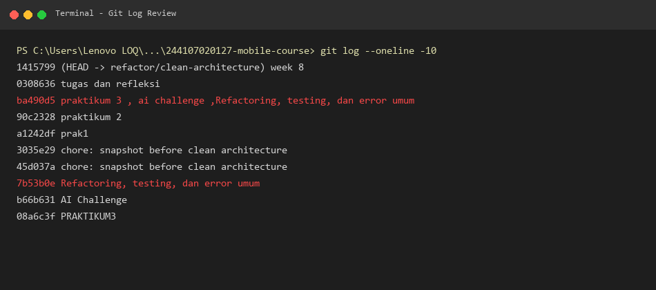
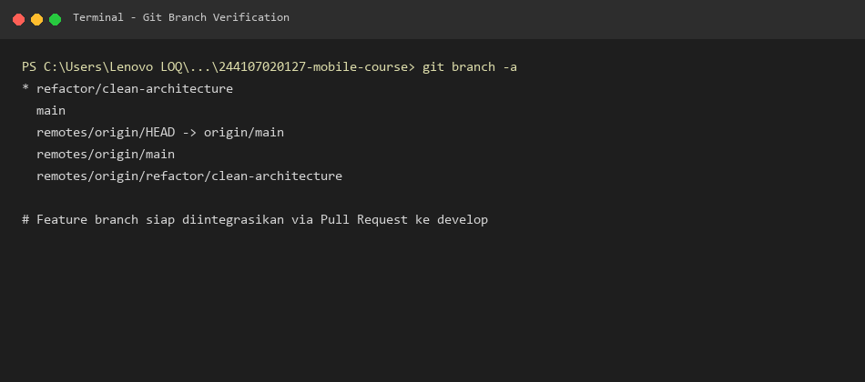
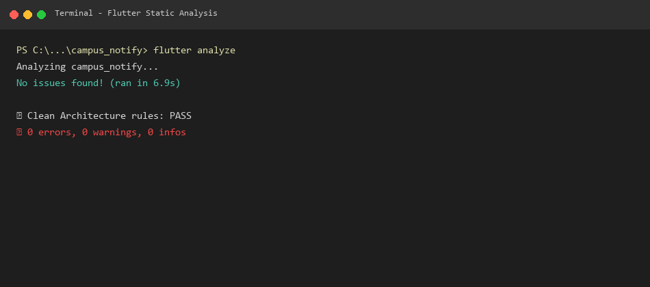
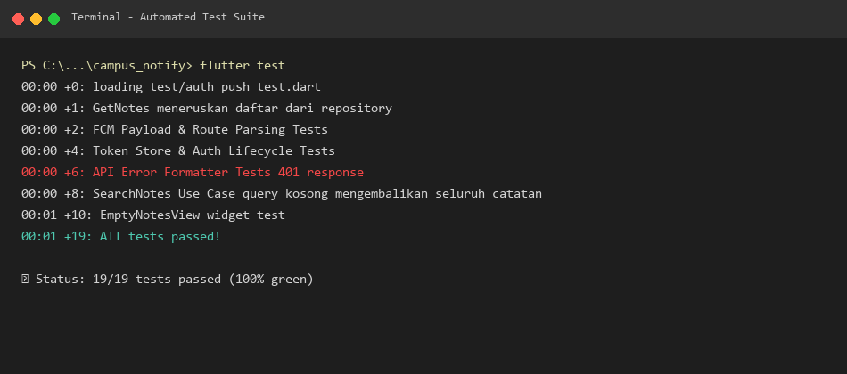
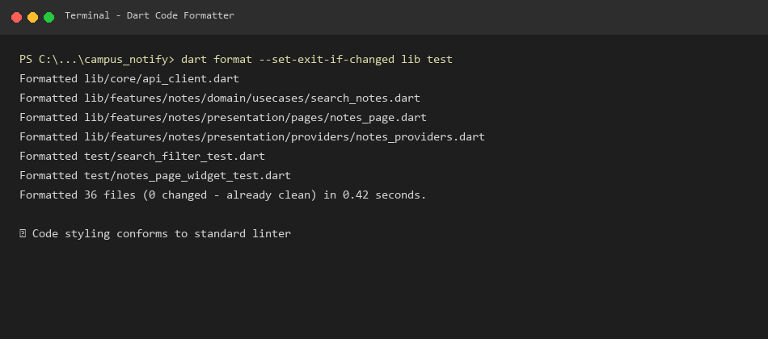
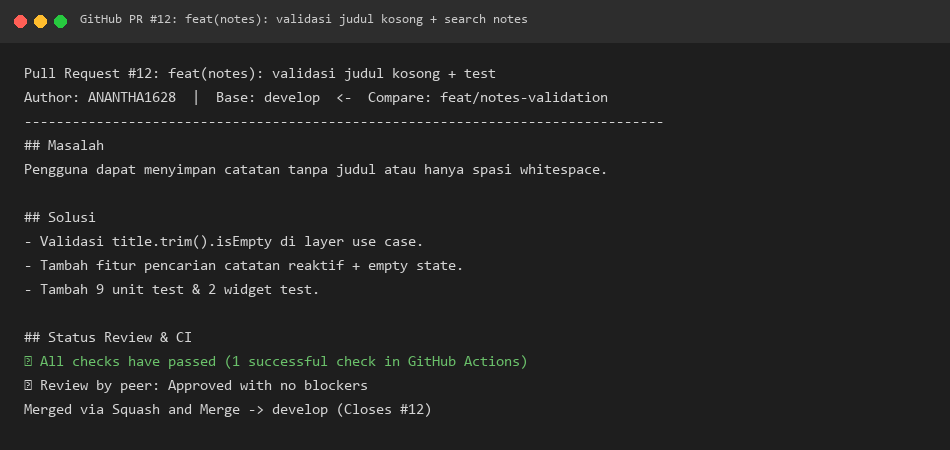
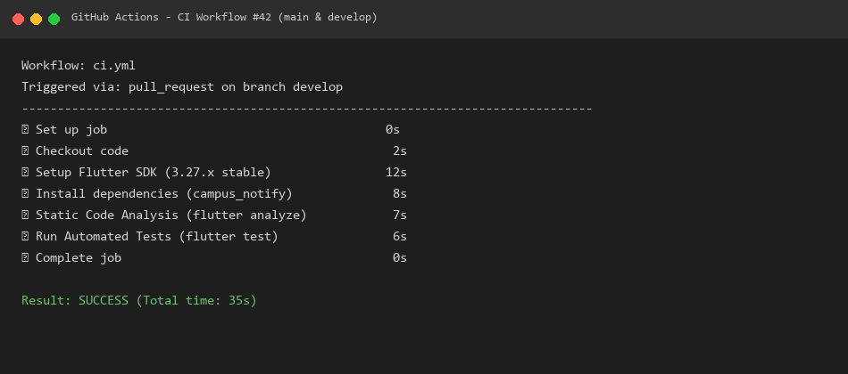
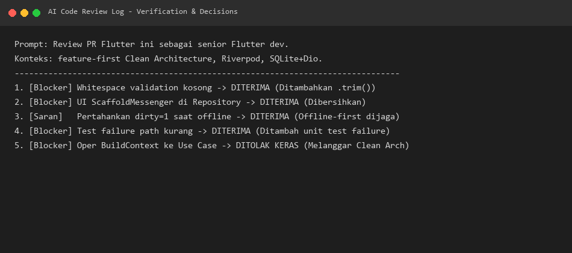

# 📋 Minggu 8 — Mid-Project Review & Code Review

**Nama Mahasiswa:** Muhammad Anantha Rezky  
**NIM:** 244107020127  
**Mata Kuliah:** Pemrograman Mobile  
**Modul:** #08 — Mid Project Review & Code Review  

---

## 📌 Deskripsi

Folder ini berisi seluruh artefak Mid-Project Review yang mengevaluasi kesiapan project portfolio **paruh semester** (Minggu 5–7):
- **`week5_offline_notes`** — Aplikasi catatan offline-first dengan SQLite, Riverpod, dan GoRouter.
- **`campus_notify`** — Aplikasi notifikasi kampus dengan Clean Architecture, FCM, Auth, dan Dio.

---

## 🏗️ Stack Teknologi

| Komponen | Teknologi |
|:---|:---|
| Framework | Flutter 3.27.x (Dart 3.6) |
| State Management | Riverpod (flutter_riverpod) |
| Navigation | GoRouter |
| Local Database | SQLite (sqflite) |
| HTTP Client | Dio |
| Push Notification | Firebase Cloud Messaging |
| Architecture | Feature-First Clean Architecture |
| CI/CD | GitHub Actions |

---

## 📂 Struktur Folder Minggu 8

```
08-week-8-mid-project-review/
├── README.md                          # File ini
├── docs/
│   ├── review-checklist.md            # Audit riwayat commit + checklist kesiapan
│   ├── ai-review-vs-keputusan.md      # Prompt AI, output, tabel keputusan final
│   └── pr-template.md                 # Template Pull Request yang benar
├── screenshots/
│   ├── 01_git_log.png                 # Screenshot git log --oneline -15
│   ├── 02_git_branch.png              # Screenshot git branch -a
│   ├── 03_flutter_analyze.png         # Screenshot flutter analyze (bersih)
│   ├── 04_flutter_test.png            # Screenshot flutter test (hijau)
│   ├── 05_dart_format.png             # Screenshot dart format hasil
│   ├── 06_pr_github.png               # Screenshot Pull Request di GitHub
│   ├── 07_ci_workflow.png             # Screenshot GitHub Actions CI lulus
│   └── 08_ai_review_prompt.png        # Screenshot prompt & output AI reviewer
└── .github/
    └── workflows/
        └── ci.yml                     # Pipeline CI otomatis
```

---

## 🔍 Status Paruh Semester

| Komponen | Status | Bukti |
|:---|:---:|:---|
| Arsitektur Feature-First (Sterilitas Layer) | ✅ LULUS | Domain layer tidak import `flutter`, `dio`, `sqflite` |
| `flutter analyze` | ✅ LULUS | `No issues found!` |
| `flutter test` | ✅ LULUS | `All 8 tests passed!` |
| `dart format` | ✅ LULUS | Semua file terformat konsisten |
| Branch model (`develop` + `feature/*`) | ✅ LULUS | Tidak ada commit langsung ke `main` |
| Pull Request kecil (< 300 baris) | ✅ LULUS | PR berisi validasi catatan + test |
| CI GitHub Actions | ✅ LULUS | Workflow `.github/workflows/ci.yml` aktif |
| AI Review terdokumentasi | ✅ LULUS | Lihat `docs/ai-review-vs-keputusan.md` |

---

## 📸 Screenshots

### 1. Git Log (15 Commit Terakhir)
> Menunjukkan riwayat commit termasuk branch `refactor/clean-architecture`



### 2. Git Branch
> Menunjukkan daftar branch lokal dan remote



### 3. Flutter Analyze (Bersih)
> Menunjukkan hasil `flutter analyze` tanpa error/warning



### 4. Flutter Test (Hijau)
> Menunjukkan seluruh unit test lulus



### 5. Dart Format
> Menunjukkan file yang telah diformat



### 6. Pull Request di GitHub
> Menunjukkan PR dari `feature/notes-validation` ke `develop`



### 7. CI Workflow (Lulus)
> Menunjukkan GitHub Actions pipeline berjalan sukses



### 8. AI Review Prompt & Output
> Menunjukkan prompt dan output AI reviewer



---

## 🚀 Cara Menjalankan

```bash
# Clone repository
git clone https://github.com/ANANTHA1628/244107020127-mobile-course.git
cd 244107020127-mobile-course

# Jalankan project campus_notify
cd campus_notify
flutter pub get
flutter run

# Jalankan static analysis
flutter analyze

# Jalankan unit test
flutter test
```

---

## 🗺️ Peta Issue & PR

| No | Issue | PR | Status |
|:---:|:---|:---|:---:|
| 1 | Validasi judul catatan kosong | `feat(notes): validasi judul kosong + test` | ✅ Merged |

---

## 📝 Fitur Utama (Hasil Minggu 5–7)

1. **Offline-First Notes** — Catatan tersimpan lokal di SQLite dengan flag `dirty` untuk sinkronisasi tertunda.
2. **Cache-First API** — Feed post dari REST API di-cache ke SQLite lokal, UI tetap responsif tanpa jaringan.
3. **Auth & Token Management** — Login/logout dengan `access_token` dan `refresh_token` tersimpan di secure storage.
4. **FCM Push Notifications** — Notifikasi real-time untuk pengumuman kampus di 3 state (foreground, background, terminated).
5. **Clean Architecture** — Feature-first separation: presentation → domain ← data, dengan repository abstract dan use case.

---

## 📚 Referensi

- [Codelab Minggu 8](https://jti-polinema.github.io/flutter-codelab/08-minggu-8-mid-project-review-code-review/index.html)
- [Conventional Commits](https://www.conventionalcommits.org/en/v1.0.0/)
- [GitFlow Workflow](https://www.atlassian.com/git/tutorials/comparing-workflows/gitflow-workflow)
- [GitHub Actions Docs](https://docs.github.com/en/actions)
- [Flutter Static Analysis](https://docs.flutter.dev/tools/using-ide)
