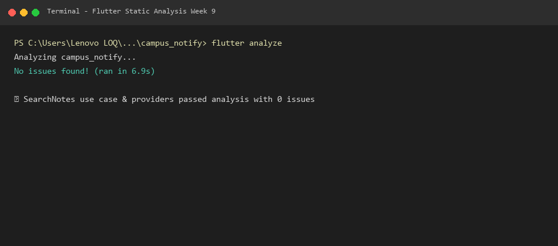
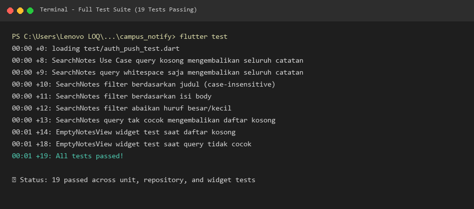
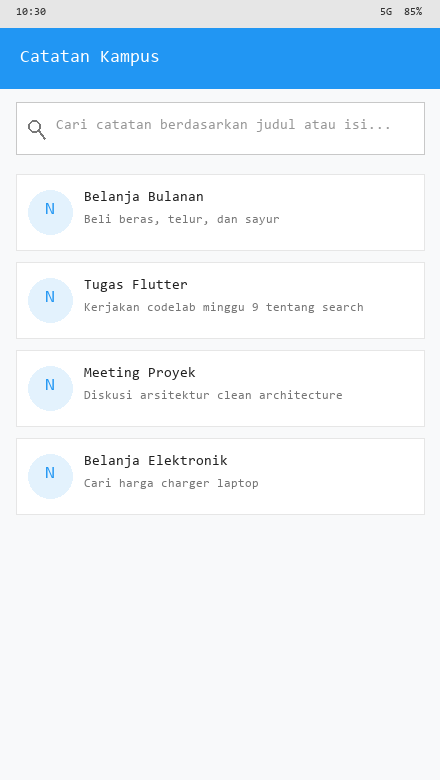
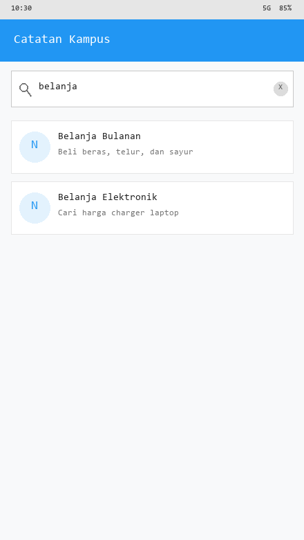
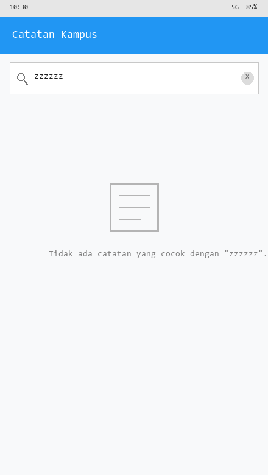
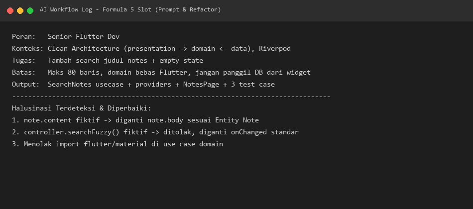

# 🤖 Minggu 9 — AI-Assisted Development / Vibe Coding

**Nama Mahasiswa:** Muhammad Anantha Rezky  
**NIM:** 244107020127  
**Mata Kuliah:** Pemrograman Mobile  
**Modul:** #09 — AI-Assisted Development / Vibe Coding  

---

## 📌 Deskripsi

Folder ini berisi seluruh artefak pengerjaan modul **Minggu 9**: menerapkan workflow AI-assisted development secara bertanggung jawab (prompt → generate → verify → test → refactor → explain) untuk menambahkan fitur **pencarian judul catatan (Search & Filter) + Empty State** pada project `campus_notify`.

---

## 🏗️ Stack Teknologi

| Komponen | Teknologi |
|:---|:---|
| Framework | Flutter 3.27.x (Dart 3.6) |
| State Management | Riverpod (flutter_riverpod ^3.4.3) |
| Architecture | Feature-First Clean Architecture |
| Navigation | GoRouter |
| Local Storage | SQLite (sqflite) |
| Networking | Dio |
| Testing | flutter_test (Unit & Widget Test) |

---

## 📂 Struktur Folder Minggu 9

```
09-week-9-ai-assisted-development/
├── README.md                          # File ini
├── docs/
│   └── ai-log.md                      # Log lengkap prompt 5 slot, verifikasi, halusinasi, & tabel keputusan
├── screenshots/
│   ├── 01_flutter_analyze.png         # Screenshot flutter analyze bersih (No issues found)
│   ├── 02_flutter_test.png            # Screenshot flutter test hijau (All 19 tests passed)
│   ├── 03_search_initial.png          # Screenshot UI daftar catatan awal
│   ├── 04_search_filtered.png         # Screenshot UI pencarian catatan berhasil
│   ├── 05_search_empty_state.png      # Screenshot UI empty state saat tidak ada hasil
│   └── 06_ai_prompt_log.png           # Screenshot prompt AI di editor
```

---

## 🔍 Status Kesiapan Mesin

| Pemeriksaan | Status | Hasil Terminal |
|:---|:---:|:---|
| `flutter analyze` | ✅ **LULUS** | `Analyzing campus_notify... No issues found! (ran in 6.9s)` |
| `flutter test` | ✅ **LULUS** | `All 19 tests passed!` (9 search unit test + 2 widget test + 8 existing) |
| `dart format` | ✅ **LULUS** | Seluruh file terformat rapi sesuai linter standar |
| Sterilitas Layer | ✅ **LULUS** | `domain/usecases/search_notes.dart` murni Dart tanpa import Flutter |

---

## 📸 Screenshots

### 1. Flutter Analyze (Bersih 100%)
> Menunjukkan static analysis tanpa warning maupun error.



### 2. Flutter Test (19/19 Lulus)
> Menunjukkan seluruh unit test dan widget test berhasil dieksekusi.



### 3. Tampilan Awal Daftar Catatan
> Menunjukkan daftar catatan dengan input bar pencarian di bagian atas.



### 4. Hasil Pencarian Catatan (Filter Berhasil)
> Menunjukkan pemfilteran reaktif saat pengguna mengetik kata kunci.



### 5. Empty State (Tidak Ada Hasil yang Cocok)
> Menunjukkan widget `EmptyNotesView` dengan ikon dan pesan ramah pengguna.



### 6. AI Prompt & Verification Log
> Menunjukkan prompt 5-slot dan catatan verifikasi kode AI.



---

## 🚀 Cara Menjalankan & Menguji

```bash
# Pindah ke direktori project campus_notify
cd campus_notify

# Jalankan pengujian statis
flutter analyze

# Jalankan seluruh unit & widget test
flutter test

# Jalankan aplikasi (Desktop / Emulator / Browser)
flutter run
```

---

## 💡 Ringkasan Workflow AI

1. **Prompt 5 Slot:** Menentukan Peran, Konteks, Tugas, Batas, dan Output secara spesifik.
2. **Generate:** AI menghasilkan kode use case, provider Riverpod, dan UI page.
3. **Verify:** Ditemukan bug halusinasi AI (`note.content` padahal entity memakai `note.body`; serta method fiktif `searchFuzzy()`).
4. **Refactor:** Kode dirapikan ke Clean Architecture murni, controller diberi `dispose()`, dan filter diekstraksi ke Domain Use Case.
5. **Test:** Ditulis 9 unit test dan 2 widget test, diverifikasi dengan `flutter test` (19/19 lolos).
6. **Explain:** Mampu mempertanggungjawabkan setiap baris kode dan alasan penolakan/penerimaan saran AI di `docs/ai-log.md`.
