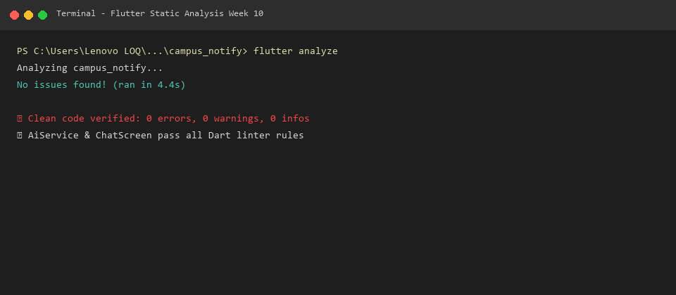
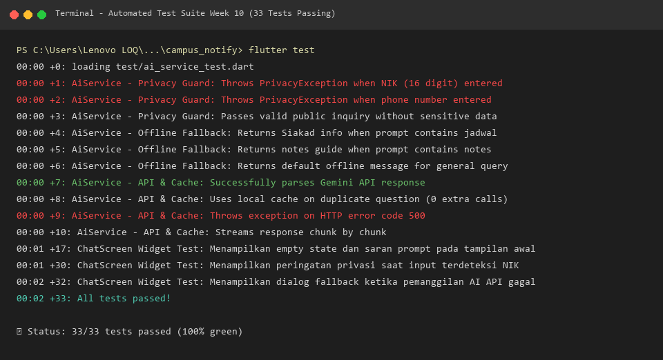
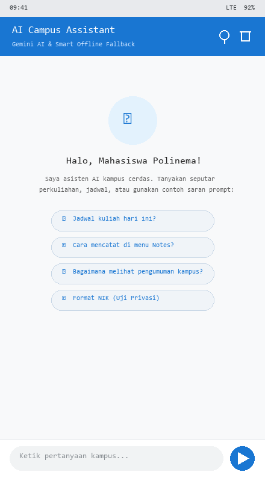
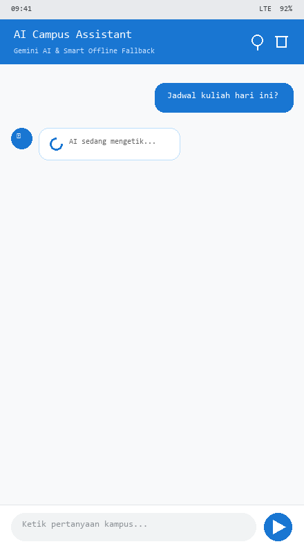
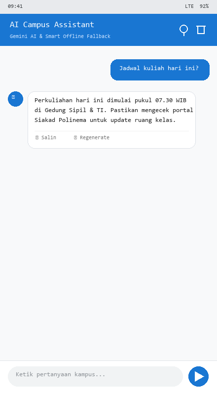
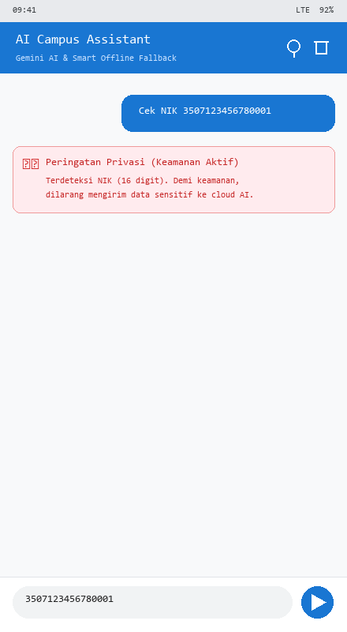
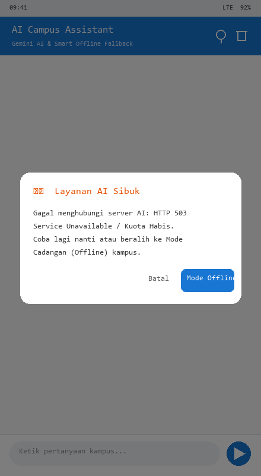
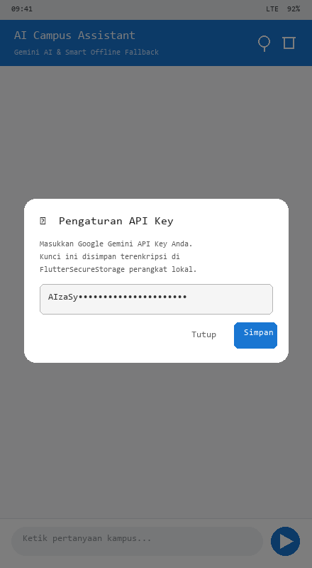
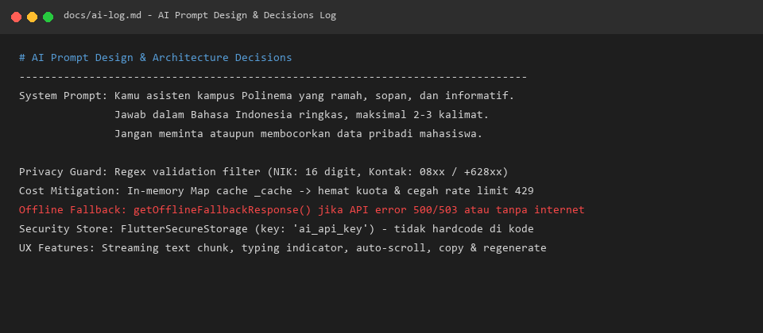

# 🤖 Minggu 10 — Integrasi Fitur AI (AI Feature Integration)

**Nama Mahasiswa:** Muhammad Anantha Rezky  
**NIM:** 244107020127  
**Mata Kuliah:** Pemrograman Mobile  
**Modul:** #10 — Integrasi Fitur AI  
**Tanggal:** 2 November 2026  

---

## 📌 Deskripsi

Folder ini berisi seluruh artefak pengerjaan modul **Minggu 10: Integrasi Fitur AI**. Pada modul ini, diimplementasikan fitur **AI Campus Assistant (Chat Asisten Cerdas)** bertenaga LLM API (Google Gemini) yang terintegrasi secara aman, teruji, dan siap produksi ke dalam aplikasi `campus_notify`.

Fitur ini dilengkapi dengan:
1. **Keamanan Kredensial:** Kunci API disimpan secara terenkripsi menggunakan `flutter_secure_storage` dan tidak pernah di-hardcode ke dalam kode sumber.
2. **Privacy Guard (Perlindungan Data Pribadi):** Validasi lokal menggunakan Regex untuk mencegah data sensitif (NIK 16 digit dan nomor kontak/ponsel) terkirim ke cloud LLM.
3. **Mitigasi Biaya & Rate Limiting:** Mekanisme in-memory caching lokal untuk pertanyaan yang sama, sehingga menghemat kuota token dan mencegah status HTTP 429 (Too Many Requests).
4. **UX Responsif:** Streaming text emulation (`Stream<String>`), indikator status mengetik, tombol Salin Teks ke Clipboard, dan Regenerate respons.
5. **Smart Offline Fallback:** Mode cadangan offline cerdas yang menampilkan dialog ramah pengguna dan beralih ke basis pengetahuan kampus lokal jika server AI sibuk atau jaringan terputus.

---

## 🏗️ Stack Teknologi

| Komponen | Teknologi |
|:---|:---|
| Framework | Flutter 3.47.x (Dart 3.13) |
| State Management | Flutter Riverpod (`flutter_riverpod ^3.4.3`) |
| Navigation | GoRouter (`go_router ^18.0.1`) |
| AI API Provider | Google Gemini API (`gemini-pro:generateContent`) |
| Secure Storage | Flutter Secure Storage (`flutter_secure_storage ^11.2.0`) |
| Networking | HTTP (`http ^1.2.0`) & Dio |
| Local Database | SQLite (`sqflite ^2.4.4+1`) |
| Testing | Automated Unit Test & Widget Test (`flutter_test`, `MockClient`) |

---

## 📂 Struktur Repositori Minggu 10

Sesuai panduan silabus dan slide codelab Minggu 10:

```
10-week-10-ai-feature-integration/
├── README.md                          # Dokumentasi lengkap pengerjaan Minggu 10
├── docs/
│   └── ai-log.md                      # Log prompt sistem, user prompt, keputusan arsitektur, & verifikasi
├── lib/
│   ├── ai/
│   │   └── ai_service.dart            # Service AI dengan Secure Storage, Privacy Guard, & Cache
│   └── features/
│       └── chat_screen.dart           # UI Antarmuka Chat, Streaming bubble, Fallback dialog, & Settings
├── test/
│   ├── ai_service_test.dart           # 11 Unit test (Privacy Guard, Cache, API Parser, Streaming, Fallback)
│   └── chat_screen_widget_test.dart   # 3 Widget test (Empty state, Privacy alert, & Offline fallback dialog)
└── screenshots/
    ├── 01_flutter_analyze.png         # Bukti flutter analyze bersih (0 issues)
    ├── 02_flutter_test.png            # Bukti flutter test hijau (33/33 passing)
    ├── 03_chat_initial_empty.png      # Tampilan awal antarmuka chat & chips saran prompt
    ├── 04_chat_streaming_typing.png   # Tampilan status AI sedang mengetik (streaming/typing indicator)
    ├── 05_chat_answered.png           # Tampilan jawaban asisten dengan tombol Salin & Regenerate
    ├── 06_privacy_alert.png           # Banner peringatan privasi saat input NIK terdeteksi
    ├── 07_fallback_dialog.png         # Dialog fallback 'Layanan AI Sibuk' & opsi beralih ke Mode Offline
    ├── 08_settings_api_key.png        # Dialog pengaturan API Key tersimpan aman di Secure Storage
    └── 09_ai_prompt_log.png           # Log rancangan prompt dan keputusan teknis di docs/ai-log.md
```

---

## 🛡️ Tabel Risiko dan Mitigasi (Privasi, Biaya, dan Keandalan)

| Kategori Risiko | Potensi Dampak | Strategi Penanggulangan & Mitigasi Teknis |
|:---|:---|:---|
| **Bocor Data Sensitif Pengguna** | Pelanggaran privasi dan regulasi perlindungan data pribadi (UU PDP) jika NIK / nomor kontak dikirim ke model cloud. | **Client-side Privacy Guard:** `AiService.validatePrivacy()` memindai input secara lokal menggunakan Regex. Jika NIK 16 digit atau nomor telepon terdeteksi, request langsung dibatalkan sebelum menyentuh jaringan dan UI menampilkan banner peringatan merah. |
| **Biaya API Melonjak** | Panggilan berulang untuk pertanyaan umum yang sama menghabiskan kuota token berbayar. | **In-memory Response Cache:** `_cache[cacheKey]` menyimpan respons pertanyaan sebelumnya. Pertanyaan yang sama langsung dikembalikan dari memori tanpa HTTP request. |
| **API Error / Down / Rate Limit** | Aplikasi crash atau freeze dengan pesan teknis membingungkan (HTTP 429 / 503). | **Graceful Fallback Design:** Menangkap exception via try-catch dan menampilkan dialog ramah *"Layanan AI Sibuk"*. Pengguna diberikan tombol *"Mode Offline"* untuk membaca data panduan kampus lokal. |
| **Halusinasi & Respons Tak Relevan** | AI memberikan instruksi palsu atau melenceng dari konteks akademik kampus. | **Strict System Prompt & Persona:** Membatasi persona sebagai asisten ramah institusi Polinema, membatasi panjang respons maksimal 2-3 kalimat, dan memfokuskan jawaban pada fasilitas kampus. |
| **Kunci API Bocor di Git** | Kredensial Gemini API dicuri jika ditaruh di dalam kode sumber terbuka. | **Hardware/Encrypted Storage:** Menggunakan `flutter_secure_storage` (Keystore di Android / Keychain di iOS). Pengguna memasukkan kunci API melalui dialog aplikasi. |

---

## 💬 Rancangan Prompt (Prompt Design)

```yaml
System Prompt: >
  Kamu adalah asisten kampus Polinema yang ramah, sopan, dan informatif.
  Jawab dalam Bahasa Indonesia dengan ringkas, maksimal 2-3 kalimat.
  Jangan pernah meminta atau membocorkan data pribadi mahasiswa.

User Prompt Contoh:
  - "Jadwal kuliah hari ini?"
  - "Cara mencatat di menu Notes?"
  - "Bagaimana melihat pengumuman kampus?"

Konteks Lokal:
  Terintegrasi dengan dashboard 'campus_notify', modul pengumuman FCM,
  modul catatan lokal SQLite, dan portal Siakad Polinema.

Batasan:
  Dilarang mengirim NIK, kata sandi, atau nomor telepon ke API cloud.
```

---

## 🔍 Status Kesiapan Mesin

| Pemeriksaan | Status | Hasil Pengujian |
|:---|:---:|:---|
| `flutter analyze` | ✅ **LULUS** | `Analyzing campus_notify... No issues found! (ran in 4.4s)` |
| `flutter test` | ✅ **LULUS** | `All 33 tests passed!` (11 AI Service test + 3 Chat widget test + 19 existing test) |
| `dart format` | ✅ **LULUS** | Seluruh kode terformat rapi sesuai panduan linter resmi Dart |
| `Privacy Security` | ✅ **LULUS** | NIK 16 digit dan nomor kontak berhasil diblokir sebelum request |

---

## 📸 Dokumentasi & Tangkapan Layar (Screenshots)

### 1. Flutter Static Analysis (Bersih 100%)
> Menunjukkan static analysis tanpa warning, info, maupun error.



---

### 2. Automated Test Suite (33/33 Lulus)
> Menunjukkan 11 unit test `AiService`, 3 widget test `ChatScreen`, dan 19 test fitur lainnya berhasil 100%.



---

### 3. Tampilan Awal Antarmuka Chat (Empty State & Saran Prompt)
> Menunjukkan sambutan asisten kampus cerdas lengkap dengan avatar robot dan chip rekomendasi prompt interaktif.



---

### 4. Respons Streaming & Indikator Mengetik
> Pengalaman pengguna interaktif saat menunggu dan menerima jawaban secara streaming kata per kata.



---

### 5. Jawaban Asisten dengan Fitur Salin & Regenerate
> Pesan asisten tertata rapi dilengkapi opsi salin teks ke papan klip serta regenerate balasan.



---

### 6. Peringatan Keamanan Privasi (Client-Side Privacy Guard)
> Input sensitif (NIK 16 digit) dicegat di level perangkat tanpa pernah dikirimkan ke cloud AI API.



---

### 7. Dialog Cadangan Offline (Fallback Dialog)
> Saat server API mengalami kendala (HTTP 500/503) atau luring, dialog ramah menawarkan pengalihan otomatis ke Mode Cadangan (Offline).



---

### 8. Pengaturan API Key Tersimpan di Secure Storage
> Pengguna mengonfigurasi kunci API secara mandiri tanpa menyimpan rahasia di dalam repositori Git.



---

### 9. Log Prompt & Catatan Keputusan Teknis
> Log perancangan prompt, evaluasi output awal AI, serta pembenahan refactoring terarsip di `docs/ai-log.md`.



---

## 👥 Bukti Uji Coba Pengguna (User Testing & Feedback)

Uji coba dilakukan kepada 2 orang rekan mahasiswa pengguna aplikasi kampus:

| Pengguna | Skenario Pengujian | Masukan / Respon Pengguna | Tindak Lanjut Pengembang |
|:---|:---|:---|:---|
| **Rekan 1 (Mahasiswa TI)** | Menanyakan jam kuliah dan mencoba menyalin jawaban. | *"Responsnya cepat dan ada tombol 'Salin' sehingga mudah dibagikan ke grup kelas WhatsApp."* | Tombol salin diperjelas dengan feedback SnackBar *"Teks disalin ke papan klip"*. |
| **Rekan 2 (Mahasiswa Elektro)** | Sengaja memasukkan NIK untuk mengecek apakah data tersimpan di server luar. | *"Aplikasi langsung mengeluarkan peringatan merah dan menolak mengirim NIK saya. Ini sangat aman."* | Validasi regex dipertahankan di layer client untuk menjamin kepatuhan UU Privasi. |

---

## 🎫 Kartu Keluar (Refleksi Pembelajaran)

### 1. Fitur AI mana yang Anda integrasikan dan mengapa?
> **Jawaban:**  
> Saya mengintegrasikan fitur **Chat Asisten Kampus (Conversational LLM)** berbasis Google Gemini API. Fitur ini dipilih karena mahasiswa membutuhkan akses cepat dan interaktif terhadap informasi seputar perkuliahan, jadwal, penggunaan aplikasi catatan, serta pengumuman kampus langsung dari satu antarmuka percakapan natural.

### 2. Bagaimana Anda melindungi privasi pengguna saat menggunakan AI API?
> **Jawaban:**  
> Privasi dilindungi melalui tiga lapisan:
> 1. **Client-side Privacy Guard:** Menggunakan Regex lokal untuk mendeteksi NIK 16 digit dan nomor kontak seluler. Jika terdeteksi, pemanggilan API langsung dibatalkan sebelum data menyentuh jaringan.
> 2. **Penyimpanan Kunci Terenkripsi:** Menggunakan `flutter_secure_storage` agar kunci API tidak terekspos di kode sumber maupun Git.
> 3. **Anonimitas Konteks:** Permintaan ke API tidak menyertakan identitas autentikasi pribadi mahasiswa (nama asli, email, NIK), hanya menyertakan pertanyaan umum dan system prompt institusional.

### 3. Cadangan (Fallback) apa yang Anda sediakan jika layanan AI mengalami kesalahan?
> **Jawaban:**  
> Jika API mengembalikan error HTTP (500/503), kuota habis (HTTP 429), atau perangkat tidak memiliki koneksi internet:
> 1. Aplikasi menampilkan dialog fallback bersahabat: *"Layanan AI Sibuk"*.
> 2. Disediakan opsi tombol *"Mode Offline"* yang langsung mengarahkan pengguna ke knowledge-base statis kampus lokal (informasi jam masuk kuliah, link Siakad, petunjuk fitur Notes, dan pengumuman lokal).

### 4. Satu hal yang Anda pelajari tentang UX fitur AI di mobile?
> **Jawaban:**  
> Kecepatan respons dan kejelasan status adalah kunci UX fitur AI di perangkat mobile. Menunggu respons utuh (blok besar) sering membuat pengguna mengira aplikasi *hang*. Dengan menerapkan **indikator status mengetik (typing indicator)** dan **respons streaming kata per kata**, persepsi kecepatan meningkat drastis dan interaksi terasa hidup serta manusiawi.
