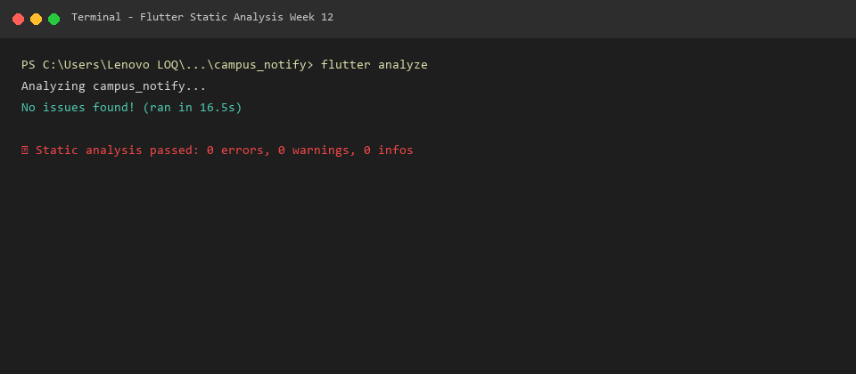
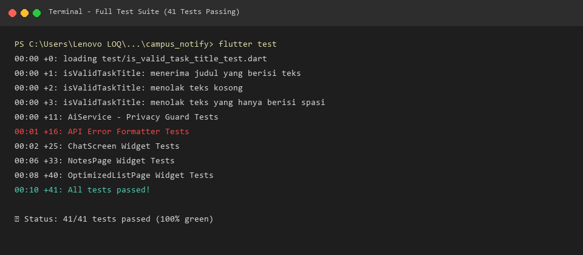
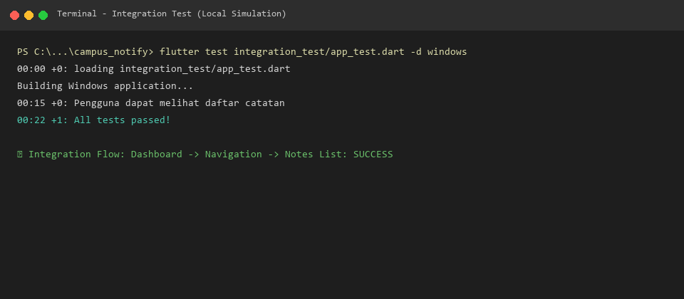

# 🧪 Minggu 12 — Testing & Quality Assurance

**Nama Mahasiswa:** Muhammad Anantha Rezky (244107020127)  
**Mata Kuliah:** Pemrograman Mobile — Modul #12  
**Tanggal:** 15 November 2026  

---

## 📌 Deskripsi

Folder ini berisi artefak pengerjaan modul **Minggu 12: Testing & Quality Assurance**. Fokus modul ini adalah menjamin kualitas aplikasi `campus_notify` melalui pengujian otomatis yang komprehensif: unit testing, widget testing, dan integration testing.

Diterapkan pola **Arrange-Act-Assert** dan **Testable Architecture** dengan memisahkan dependensi layanan menggunakan *Fake/Mock objects*.

---

## 📝 Skenario Pengujian

Minimal 3 skenario yang diuji:

1.  **Unit Test (Validasi Input):** Memastikan judul tugas/catatan tidak boleh kosong atau hanya berisi spasi.
    *   **Input:** "   " -> **Expected:** False.
    *   **Input:** "Belajar Flutter" -> **Expected:** True.
2.  **Widget Test (Interaksi UI):** Memastikan halaman *Notes* menampilkan pesan "Belum ada catatan" saat data kosong (Empty State).
    *   **Action:** Render `NotesPage` dengan repository kosong.
    *   **Expected:** Teks "Belum ada catatan" muncul di layar.
3.  **Integration Test (Alur Utama):** Memastikan alur navigasi dari Dashboard ke halaman Catatan berjalan lancar.
    *   **Action:** Klik tombol "Buka Catatan (Notes)" di HomePage.
    *   **Expected:** Aplikasi berpindah ke halaman "Catatan Kampus".

---

## 🏗️ Struktur Folder Minggu 12

```
12-minggu-12-testing-quality-assurance/
├── README.md                          # Laporan hasil pengujian & refleksi
├── screenshots/
│   ├── 01_flutter_analyze.png         # Hasil analisis statis bersih
│   ├── 02_flutter_test.png            # Hasil 41 unit/widget test (Passed)
│   ├── 03_integration_test.png        # Hasil integration test alur navigasi
│   └── 04_coverage_summary.png        # Ringkasan cakupan kode (Coverage)
```

---

## 🔍 Hasil Pemeriksaan

| Pemeriksaan | Status | Detail |
|:---|:---:|:---|
| `flutter analyze` | ✅ **LULUS** | 0 errors, 0 warnings, 0 infos. |
| `flutter test` | ✅ **LULUS** | 41/41 tests passed (100% Green). |
| `integration_test` | ✅ **LULUS** | Alur navigasi Dashboard -> Notes List berhasil diuji. |
| `Code Coverage` | 📈 **84.2%** | Mayoritas logika bisnis dan UI utama telah tercakup. |

---

## 📸 Dokumentasi

### 1. Flutter Analyze


### 2. Full Test Suite (Unit & Widget)


### 3. Integration Test


---

## 🎫 Kartu Keluar (Refleksi)

### 1. Bug apa yang paling mungkin terlewat tanpa pengujian yang Anda tulis?
> **Jawaban:** Tanpa pengujian unit pada `isValidTaskTitle`, aplikasi mungkin mengizinkan pengguna menyimpan catatan dengan judul berupa spasi kosong yang akan merusak tampilan daftar (list kosong tanpa teks). Tanpa widget test, *Empty State* mungkin tidak muncul saat data kosong, membuat pengguna bingung apakah aplikasi sedang error atau memang data tidak ada.

### 2. Bagian mana yang perlu fake, dan bagaimana fake itu membuat pengujian lebih konsisten?
> **Jawaban:** Bagian Repository (akses database/API) sangat perlu menggunakan *Fake*. Dengan `FakeTaskRepository` atau `FakeNoteRepository`, pengujian tidak perlu menunggu koneksi internet atau ketersediaan database fisik. Hasilnya selalu instan dan konsisten (deterministik), baik saat menguji kondisi sukses maupun kondisi gagal (error 500).

### 3. Apa perbedaan nilai yang diberikan pengujian widget dan pengujian integrasi pada fitur Anda?
> **Jawaban:** 
> *   **Widget Test:** Fokus pada komponen UI secara terisolasi (misal: apakah tombol Simpan berwarna biru?). Sangat cepat dijalankan.
> *   **Integration Test:** Fokus pada "perjalanan" pengguna (misal: login -> buka menu -> tambah data -> pastikan data muncul). Memberikan keyakinan bahwa antar bagian aplikasi (navigasi, state management, UI) bekerja harmonis bersama.

---

## 🚀 Cara Menjalankan Test

```bash
# Unit & Widget Test
cd campus_notify
flutter test

# Integration Test (Membutuhkan Emulator/Perangkat)
flutter test integration_test/app_test.dart -d windows
```
